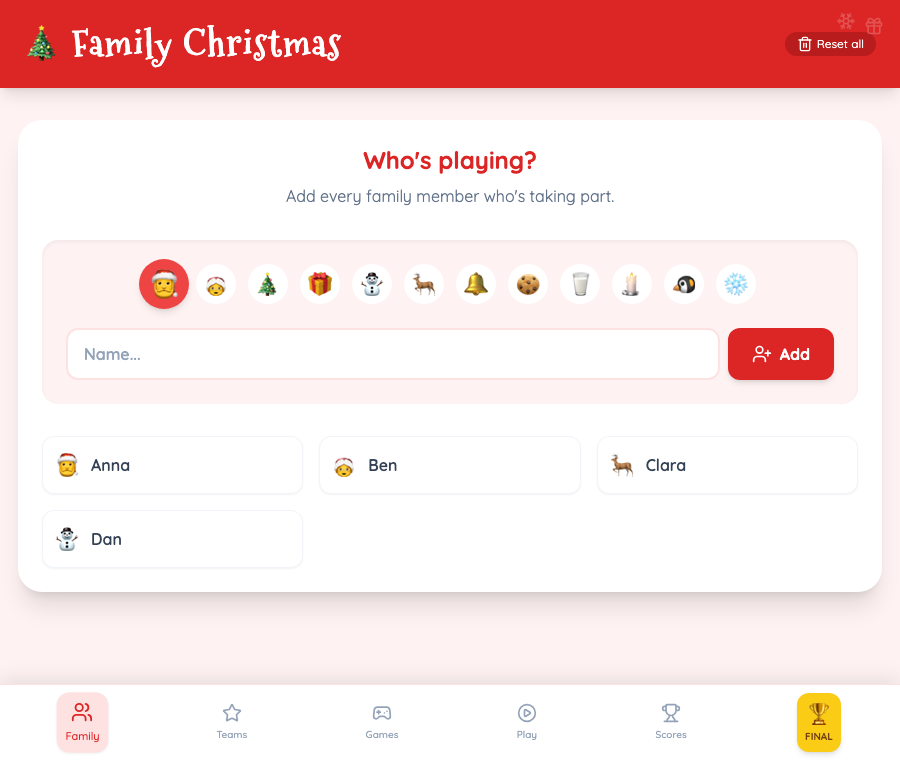

# 🎄 Family Christmas Games


[](https://mccprogrammer.github.io/Family-Christmas-Games/)

A festive web app to run your family's Christmas games: split everyone into teams, play timed or points-based challenges, keep a live scoreboard and crown the winners on an animated podium.

▶️ **Play it:** [mccprogrammer.github.io/Family-Christmas-Games](https://mccprogrammer.github.io/Family-Christmas-Games/)



## How it works

1. **Family:** add everyone who's playing, each with a Christmas avatar.
2. **Teams:** create teams with a colour and click on people to put them in a team.
3. **Games:** add the challenges. Each one is either:
   - **Time:** a stopwatch runs and the fastest team wins, or
   - **Points:** you type in a score (e.g. "Baubles caught") and the highest wins.
4. **Play:** pick a game and two teams for a duel.
   - In timed games, each team taps **Done!** when it finishes.
   - In points games, you enter each team's result.
   - Play as many duels as you like. The best result of each team counts.
5. **Confirm and award points:** teams are ranked and get points: every team scores, and the winner gets 2 more than second place.
6. **Scores:** the leaderboard and the history of every game.
7. **Final:** the podium reveals 3rd, 2nd and 1st place with a drum roll, sound effects and confetti.

Everything is saved in the browser (`localStorage`), so a refresh doesn't lose the game. **Reset all** clears it for next year.

## Running it locally

```bash
npm install
npm run dev      # http://localhost:3000
npm run build    # static site in dist/
```

Every push to `master` builds the app and publishes it to GitHub Pages (`.github/workflows/deploy.yml`).

## Tech

React 19 · TypeScript · Vite · Tailwind CSS · lucide-react icons · canvas-confetti
